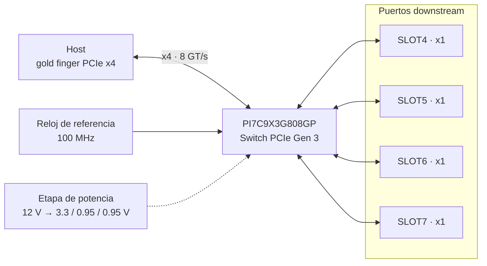
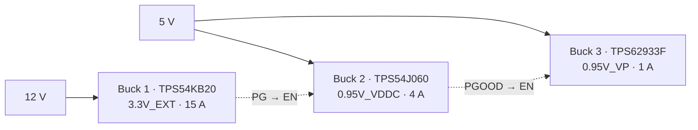

# Switch PCIe Gen 3 de 8 puertos — PI7C9X3G808GP

<div align="center">
  <em>Universidad del Istmo de Guatemala</em><br>
  <em>Facultad de Ingeniería</em><br>
  <em>Switch PCIe Gen 3 — PI7C9X3G808GP</em><br>
  <em>Electrónica 2</em>

  <br><br>

  

  <br><br>

  <em>Kevin Flores</em><br>
  <em>Octubre de 2026</em>

  <br><br>

  
  -0A66C2)
  
  
</div>

---

## Tabla de contenido

1. [Descripción general](#descripción-general)
2. [Especificaciones principales](#especificaciones-principales)
3. [Objetivos](#objetivos)
4. [Arquitectura del sistema](#arquitectura-del-sistema)
5. [Etapa de potencia](#etapa-de-potencia)
6. [Componentes principales](#componentes-principales)
7. [Herramientas de diseño](#herramientas-de-diseño)
8. [Estructura del repositorio](#estructura-del-repositorio)
9. [Cómo abrir el proyecto](#cómo-abrir-el-proyecto)
10. [Estado del proyecto](#estado-del-proyecto)
11. [Aviso](#aviso)
12. [Autor](#autor)

---

## Descripción general

Este repositorio contiene el diseño de hardware de una tarjeta de expansión **PCI Express Gen 3** basada en el switch de paquetes **Diodes PI7C9X3G808GP**. La tarjeta toma un enlace **x4** del host a través del conector de borde (*gold finger*) y lo distribuye en **cuatro ranuras PCIe x1** para periféricos.

El proyecto cubre el flujo completo de diseño en Cadence OrCAD X: captura esquemática, diseño propio de la etapa de potencia, creación de símbolos y *footprints*, layout de la PCB con ruteo de pares diferenciales de alta velocidad y generación de archivos de fabricación.

El diseño parte del esquemático de referencia de la tarjeta de evaluación del fabricante. Sobre esa base, la **etapa de potencia se rediseñó por completo** con tres convertidores *buck* discretos dimensionados en TI WEBENCH.

## Especificaciones principales

| Parámetro | Valor |
|---|---|
| Switch | Diodes PI7C9X3G808GP: 8 puertos, 8 *lanes*, PCIe Gen 3 (8 GT/s) |
| Upstream | 1 × PCIe x4, conector de borde |
| Downstream | 4 × PCIe x1, ranuras SLOT4 a SLOT7 |
| Entrada de alimentación | 12 V |
| Rieles generados | 3.3 V (15 A) · 0.95 V núcleo VDDC (4 A) · 0.95 V SerDes VP (1 A) |
| Reloj de referencia | 100 MHz, distribuido al switch y a las ranuras |
| Herramienta | Cadence OrCAD X PCB Professional Plus 25.1 |

## Objetivos

**General:** diseñar el esquemático y el layout de una tarjeta switch PCIe Gen 3 en OrCAD X, lista para fabricación y sin errores de DRC.

**Específicos:**

- Completar el esquemático jerárquico del switch, sus puertos upstream y downstream, el reloj de referencia y la configuración por *straps*.
- Diseñar desde cero tres convertidores *buck* con TI WEBENCH, junto con sus símbolos y *footprints*.
- Rutear los pares diferenciales PCIe con impedancia controlada (85 Ω diferencial), igualación de longitudes y referencia continua a plano de tierra.
- Diseñar la red de distribución de potencia (PDN) con su desacoplo y su secuencia de encendido.
- Generar la documentación y los archivos de fabricación (Gerbers, taladros, BOM).

## Arquitectura del sistema



## Etapa de potencia

Los tres rieles se generan con convertidores *buck* de Texas Instruments, dimensionados en WEBENCH y ajustados a mano para cumplir las tolerancias del switch.



| Riel | Controlador | Frecuencia | Inductor | Eficiencia* | Rizado* |
|---|---|---|---|---|---|
| 3.3V_EXT | TPS54KB20 | 800 kHz | Coilcraft XAL8080, 680 nH | 94.5 % | 6.8 mVpp |
| 0.95V_VDDC | TPS54J060 | 1.1 MHz | Coilcraft XAL5020, 560 nH | 84.9 % | 4.5 mVpp |
| 0.95V_VP | TPS62933F | 500 kHz | Coilcraft XAL7030, 1.5 µH | 89.4 % | 3.0 mVpp |

<sub>* Resultados de simulación en WEBENCH a plena carga y T<sub>a</sub> = 50 °C.</sub>

**Decisiones de diseño destacadas:**

- **Secuencia de encendido:** 3.3 V → VDDC (núcleo) → VP (SerDes), encadenando las señales *Power Good* de cada convertidor con el *enable* del siguiente.
- **Ajuste del punto de operación de VDDC:** se fijó en 0.96 V con resistencias de realimentación de 0.1 % para compensar la caída en la ferrita de filtrado y garantizar ≥ 0.90 V en las bolas del switch en el peor caso.
- **Modo FCCM (PWM forzado)** en los rieles de 0.95 V para evitar el ruido de baja frecuencia del modo PFM sobre el núcleo y las SerDes.
- **Familia de inductores unificada** (Coilcraft XAL) para simplificar *footprints* y compras.

El detalle de cada diseño (requisitos, BOM y alternativas descartadas) está en [`docs/webench/`](docs/webench/).

## Componentes principales

| Función | Componente |
|---|---|
| Switch PCIe Gen 3 | Diodes PI7C9X3G808GP |
| Buck 3.3 V / 15 A | TI TPS54KB20 |
| Buck 0.95 V / 4 A (núcleo) | TI TPS54J060 |
| Buck 0.95 V / 1 A (SerDes) | TI TPS62933F |
| Inductores de potencia | Coilcraft XAL8080 · XAL5020 · XAL7030 |
| Conectores | Gold finger PCIe x4 · 4 ranuras PCIe x1 |

## Herramientas de diseño

| Herramienta | Uso |
|---|---|
| Cadence OrCAD X Capture CIS 25.1 | Captura esquemática jerárquica y DRC |
| Cadence OrCAD X PCB / Allegro 25.1 | Layout, *stack-up*, ruteo y Gerbers |
| Cadence Padstack Editor 25.1 | *Padstacks* y *footprints* propios |
| TI WEBENCH Power Designer | Dimensionamiento de los convertidores *buck* |
| Git / GitHub | Control de versiones |

## Estructura del repositorio

```
PCIe808_SW/
├── PI7_KEVINFLORES.opj      Proyecto de OrCAD Capture
├── PI7_KEVINFLORES.DSN      Esquemático
├── abrir_proyecto.cmd       Lanzador (monta la carpeta como unidad P:)
├── allegro/                 Layout de la PCB (.brd)
├── library/                 Símbolos de Capture propios (.olb)
├── symbols/                 Footprints y padstacks propios (.dra .psm .pad)
├── docs/
│   ├── webench/             Diseño de los convertidores buck
│   └── img/                 Imágenes del README
└── outputs/                 Entregables: PDF, BOM, Gerbers y reportes (DRC, import)
```

## Cómo abrir el proyecto

1. Clonar el repositorio:
   ```bash
   git clone https://github.com/ksflores-cmyk/PCIe808_SW.git
   ```
2. Abrir `PI7_KEVINFLORES.opj` con **OrCAD X Capture CIS 25.1**.
3. Si la ruta contiene espacios, ejecutar `abrir_proyecto.cmd`, que monta la carpeta como la unidad `P:`, porque Cadence no maneja bien las rutas con espacios.

## Estado del proyecto

- [x] Esquemático base del switch, los puertos y el reloj
- [x] Diseño de los tres convertidores *buck* (WEBENCH, símbolos y *footprints*)
- [x] Integración de la etapa de potencia en el esquemático
- [x] Verificación DRC del esquemático completo (0 errores)
- [x] Netlist del esquemático importado a la PCB
- [ ] Librería de *footprints* completa
- [ ] *Placement* y ruteo de alta velocidad y potencia
- [ ] Ruteo del sistema de control
- [ ] Archivos de fabricación (Gerbers, taladros, BOM)

## Aviso

Este diseño es una versión académica personalizada, desarrollada a partir del material de referencia del fabricante proporcionado por el curso. El *design kit* original no se incluye en este repositorio. El contenido se publica con fines educativos y de portafolio; no es un diseño validado para fabricación y se ofrece "tal cual", sin garantía. Cualquier uso o reproducción es responsabilidad de quien lo realice.

## Autor

**Kevin Sebastián Flores López**: estudiante de Ingeniería Electrónica y Telecomunicaciones, Universidad del Istmo de Guatemala.
[github.com/ksflores-cmyk](https://github.com/ksflores-cmyk)
