# Switch PCIe Gen 3 de 8 puertos — PI7C9X3G808GP

<div align="center">
  <em>Universidad del Istmo de Guatemala</em><br>
  <em>Facultad de Ingeniería</em><br>
  <em>Switch PCIe Gen 3 — PI7C9X3G808GP</em><br>
  <em>Electrónica 2</em>

  <br><br>

  

  <br><br>

  <em>Kevin Flores</em><br>
  <em>Noviembre de 2026</em>

  <br><br>

  
  -0A66C2)
  
  
  
  
</div>

---

## Tabla de contenido

1. [Descripción general](#descripción-general)
2. [Vista general del diseño](#vista-general-del-diseño)
3. [Especificaciones principales](#especificaciones-principales)
4. [Objetivos](#objetivos)
5. [Arquitectura del sistema](#arquitectura-del-sistema)
6. [Esquemático](#esquemático)
7. [Etapa de potencia](#etapa-de-potencia)
8. [Layout de la PCB](#layout-de-la-pcb)
9. [Componentes principales](#componentes-principales)
10. [Herramientas de diseño](#herramientas-de-diseño)
11. [Estructura del repositorio](#estructura-del-repositorio)
12. [Cómo abrir el proyecto](#cómo-abrir-el-proyecto)
13. [Estado del proyecto](#estado-del-proyecto)
14. [Entregables de fabricación](#entregables-de-fabricación)
15. [Aviso](#aviso)
16. [Autor](#autor)

---

## Descripción general

Este repositorio contiene el diseño de hardware de una tarjeta de expansión **PCI Express Gen 3** basada en el switch de paquetes **Diodes PI7C9X3G808GP**. La tarjeta toma un enlace **x4** del host a través del conector de borde (*gold finger*) y lo distribuye en **cuatro conectores M.2 M-key 2280 (NVMe)**, cada uno con un enlace PCIe x1.

El proyecto cubre el flujo completo de diseño en Cadence OrCAD X: captura esquemática, diseño propio de la etapa de potencia, creación de símbolos y *footprints*, layout de la PCB con ruteo de pares diferenciales de alta velocidad, y generación de los archivos de fabricación y de la lista de materiales.

El diseño parte del esquemático de referencia de la tarjeta de evaluación del fabricante. Sobre esa base, la **etapa de potencia se rediseñó por completo** con tres convertidores *buck* discretos dimensionados en TI WEBENCH.

## Vista general del diseño

<table>
  <tr>
    <td align="center" width="50%">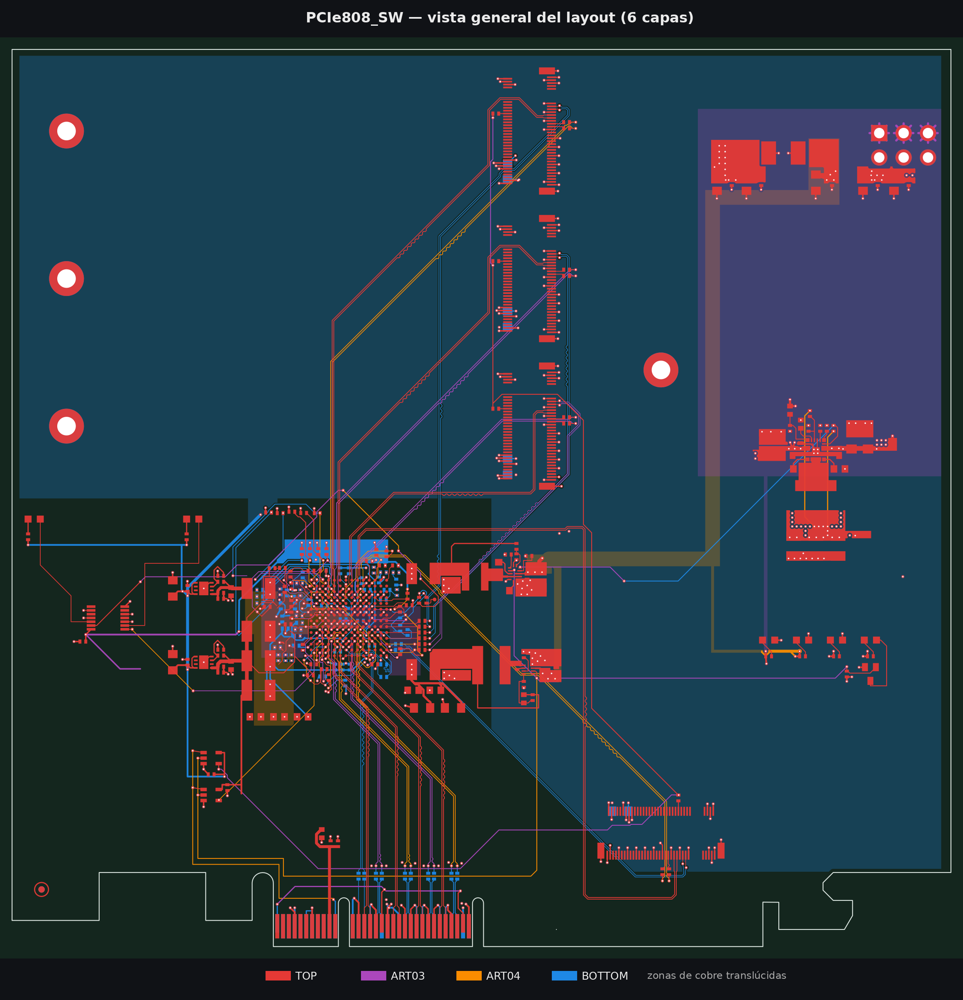<br><sub>Layout completo, generado desde los Gerbers de fabricación: capas de señal superpuestas y pads en dorado.</sub></td>
    <td align="center" width="50%">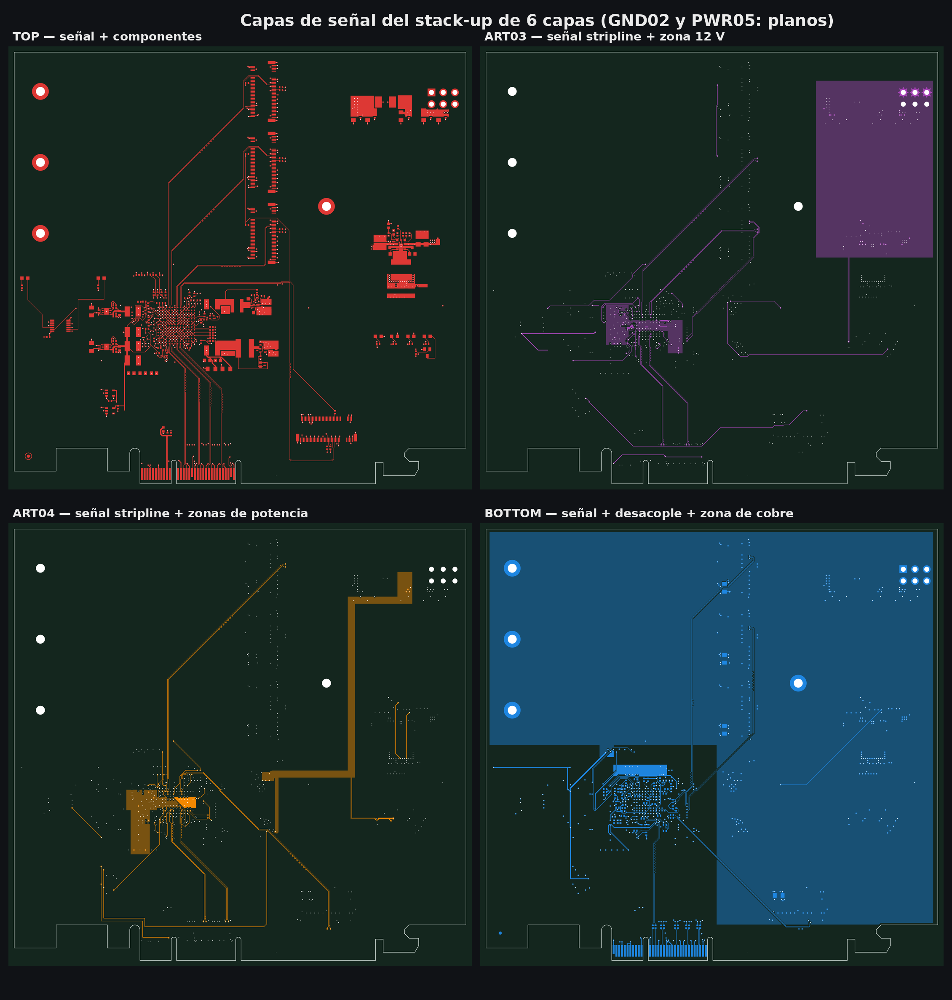<br><sub>Capas de cobre por separado: TOP, GND02, ART03, ART04, PWR05 y BOTTOM.</sub></td>
  </tr>
</table>

<p align="center">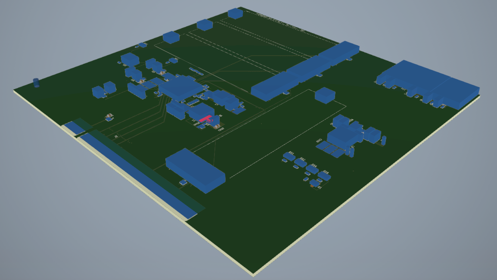<br><sub>Vista 3D de la tarjeta (Allegro 3DX Canvas). Los componentes se muestran como bloques genéricos con la altura de su <i>footprint</i>, ya que no se asociaron modelos STEP.</sub></p>

## Especificaciones principales

| Parámetro | Valor |
|---|---|
| Switch | Diodes PI7C9X3G808GP: 8 puertos, 8 *lanes*, PCIe Gen 3 (8 GT/s) |
| Upstream | 1 × PCIe x4, conector de borde |
| Downstream | 4 × PCIe x1, conectores M.2 M-key 2280 (J1 a J4) |
| Entrada de alimentación | 12 V (conector PCIe de 6 pines) y 5 V (Molex de 4 pines) |
| Rieles generados | 3.3 V (15 A) · 0.95 V núcleo VDDC (4 A) · 0.95 V SerDes VP (1 A) · 1.8 V y 0.95 V C_VDDC con LDO |
| Configuración del switch | Por *straps*, sin EEPROM |
| Reloj de referencia | 100 MHz, distribuido al switch y a los conectores M.2 |
| PCB | 6 capas, 242 componentes, 170 redes, fabricación en JLCPCB |
| Herramienta | Cadence OrCAD X PCB Professional Plus 25.1 |

## Objetivos

**General:** diseñar el esquemático y el layout de una tarjeta switch PCIe Gen 3 en OrCAD X, lista para fabricación y sin errores de DRC.

**Específicos:**

- Completar el esquemático del switch, sus puertos upstream y downstream, el reloj de referencia y la configuración por *straps*.
- Diseñar desde cero tres convertidores *buck* con TI WEBENCH, junto con sus símbolos y *footprints*.
- Rutear los pares diferenciales PCIe con impedancia controlada (85 Ω diferencial), igualación de longitudes y referencia continua a plano de tierra.
- Diseñar la red de distribución de potencia (PDN) con su desacoplo y su secuencia de encendido.
- Generar la documentación, los archivos de fabricación (Gerbers, taladros) y la lista de materiales.

## Arquitectura del sistema

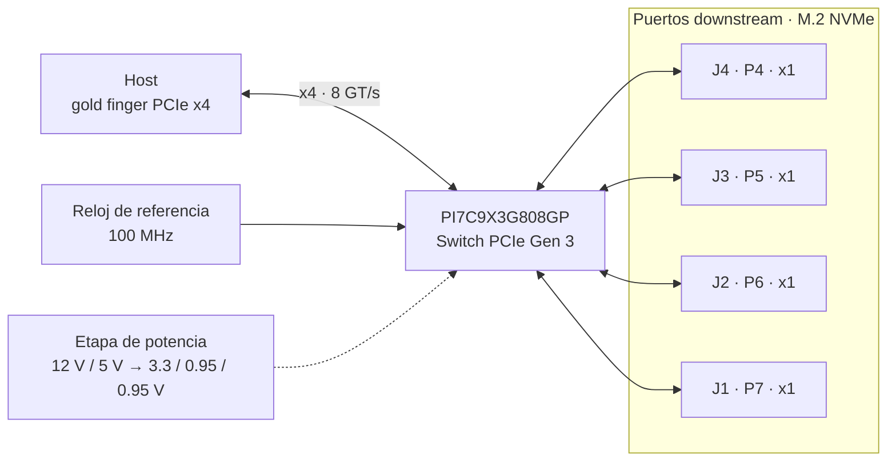

## Esquemático

El esquemático tiene **15 hojas**, cada una con cajetín (título, número de hoja, revisión y autor). El PDF completo, con marcadores por hoja, está en [`outputs/PI7_KEVINFLORES_esquematico.pdf`](outputs/PI7_KEVINFLORES_esquematico.pdf).

| Hoja | Contenido | Hoja | Contenido |
|---|---|---|---|
| 01 | Portada | 09 | U6A: alimentación y desacople del switch |
| 02 | Índice de hojas | 10 | Upstream PCIe x4 (puerto 0) |
| 03 | Diagrama de bloques y árbol de potencia | 11 | U6C: pares diferenciales PCIe |
| 04 | Entrada de potencia 12 V / 5 V | 12 | M.2 NVMe, puertos downstream 4 a 7 |
| 05 | Buck 1: 12 V → 3.3 V | 13 | U6D: reloj de referencia |
| 06 | Buck 2: 5 V → 0.95 V VDDC | 14 | U6B: configuración, *straps*, SMBus y JTAG |
| 07 | Buck 3: 5 V → 0.95 V VP | 15 | U6E: GPIO y header J11 |
| 08 | LDO 0.95 V C_VDDC y 1.8 V | | |

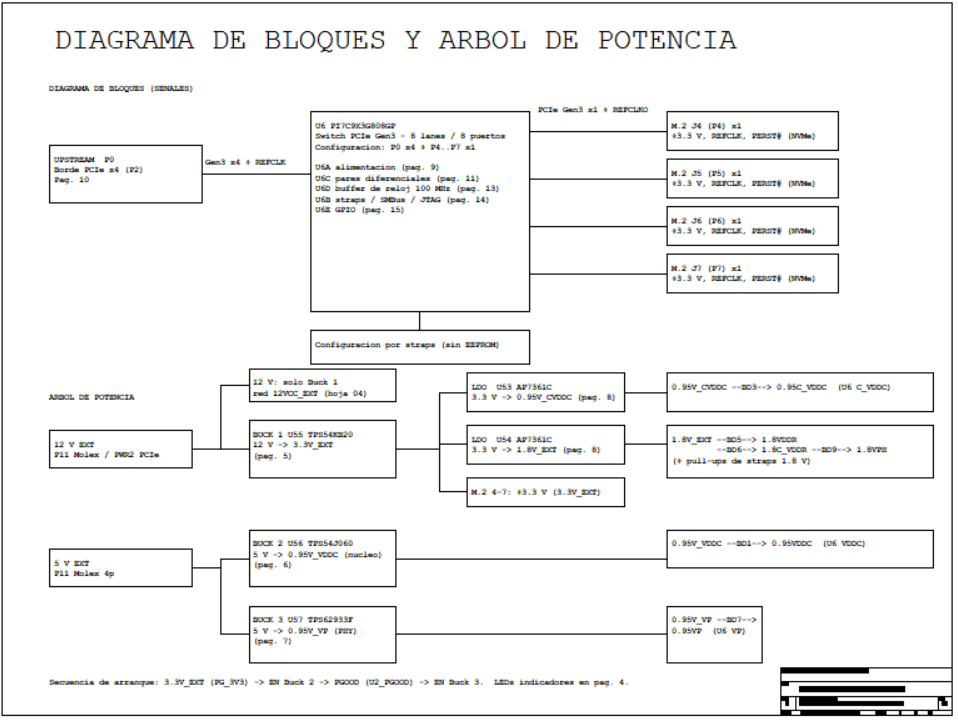

Cada convertidor ocupa su propia hoja y está dibujado con todas sus conexiones (entrada, *bootstrap*, inductor, divisor de realimentación y arranque suave), no solo con etiquetas. Cada hoja incluye un cuadro de **notas de diseño** con el cálculo de Vout, la frecuencia, el límite de corriente, el arranque suave y la secuencia de encendido. Las señales que pasan de una hoja a otra (PG_3V3 y U2_PGOOD) usan conectores *off-page* con referencia a la hoja destino. El índice incluye el historial de revisiones.

<table>
  <tr>
    <td align="center" width="50%">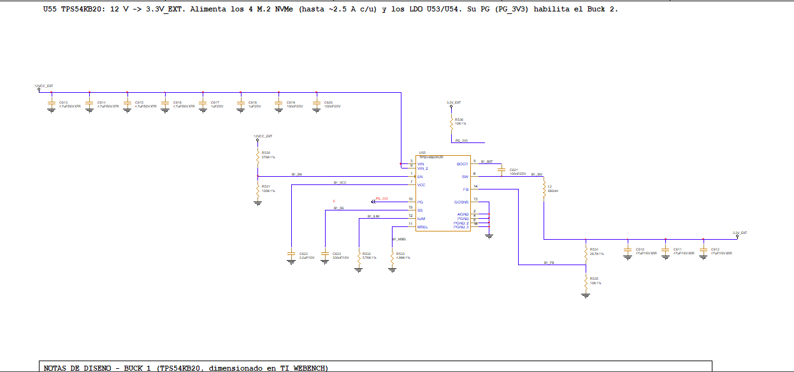<br><sub>Hoja 05: Buck 1, 12 V → 3.3 V (TPS54KB20).</sub></td>
    <td align="center" width="50%">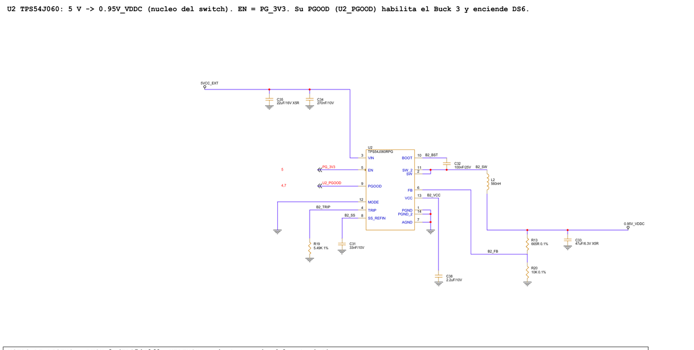<br><sub>Hoja 06: Buck 2, 5 V → 0.95 V VDDC (TPS54J060).</sub></td>
  </tr>
  <tr>
    <td align="center" width="50%">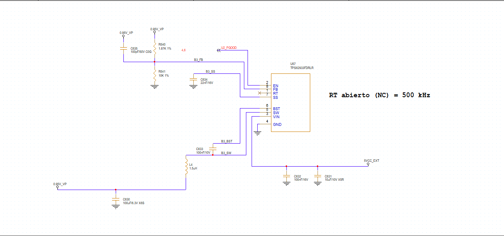<br><sub>Hoja 07: Buck 3, 5 V → 0.95 V VP (TPS62933F).</sub></td>
    <td align="center" width="50%">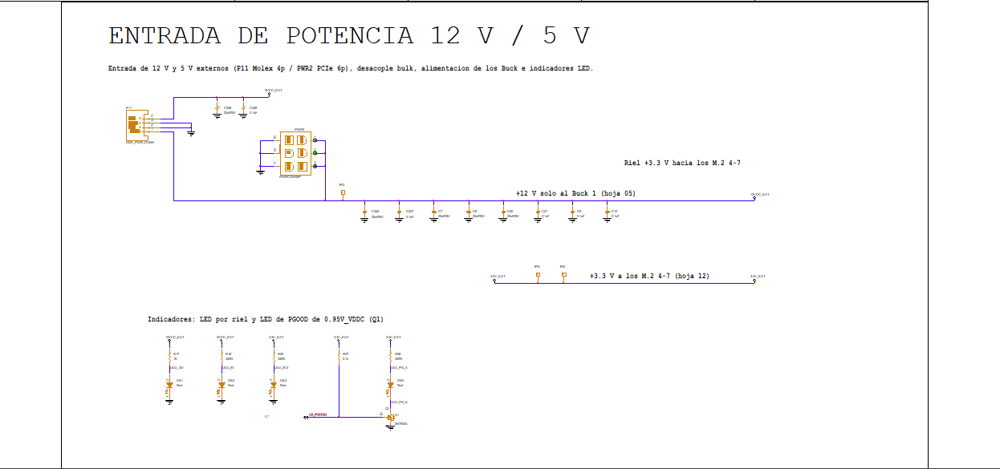<br><sub>Hoja 04: entrada de 12 V / 5 V, distribución e indicadores.</sub></td>
  </tr>
</table>

**Configuración del switch por *straps*** (hoja 14): PORTCFG[2:0] = 100b (P0 x4 + P4–P7 x1), *Hot-Plug*, L1.1 y modo *debug* deshabilitados, y RESREF de 200 Ω 1 % a GND. No se usa EEPROM: el switch arranca solo con esta configuración.

### Verificación del esquemático (DRC)

El DRC de Capture se corre con todas las reglas eléctricas activas (incluidas las de conectores *off-page*) y con la matriz ERC configurada para marcar como *warning* cualquier pin sin conectar, de cualquier tipo. El reporte completo está en [`outputs/reportes/esquematico_DRC.txt`](outputs/reportes/esquematico_DRC.txt).

| Resultado | Cantidad | Explicación |
|---|---|---|
| Errores | **0** | — |
| Pines sin conectar | **0** | Todo pin libre está marcado como *No Connect*. |
| Avisos de alias (ORCAP-1589) | 68 | Informativos: los pines de tipo *Power* (VSS, VDDC, +12V, etc.) llevan su propio nombre de red además de la red a la que están cableados. Es el comportamiento normal de esos símbolos. |

## Etapa de potencia

Los tres rieles principales se generan con convertidores *buck* de Texas Instruments, dimensionados en WEBENCH y ajustados a mano para cumplir las tolerancias del switch. Los rieles auxiliares de 1.8 V y 0.95 V C_VDDC salen de LDO.

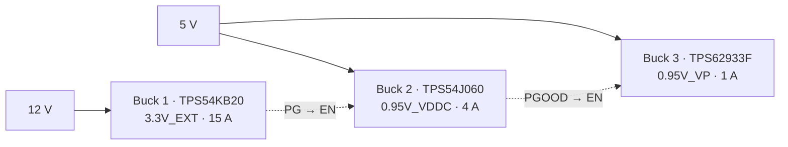

| Riel | Controlador | Frecuencia | Inductor | Eficiencia* | Rizado* |
|---|---|---|---|---|---|
| 3.3V_EXT | TPS54KB20 | 800 kHz | Coilcraft XAL8080, 680 nH | 94.5 % | 6.8 mVpp |
| 0.95V_VDDC | TPS54J060 | 1.1 MHz | Coilcraft XAL5020, 560 nH | 84.9 % | 4.5 mVpp |
| 0.95V_VP | TPS62933F | 500 kHz | Coilcraft XAL7030, 1.5 µH | 89.4 % | 3.0 mVpp |

<sub>* Resultados de simulación en WEBENCH a plena carga y T<sub>a</sub> = 50 °C.</sub>

**Decisiones de diseño destacadas:**

- **Secuencia de encendido:** 3.3 V → VDDC (núcleo) → VP (SerDes), encadenando las señales *Power Good* de cada convertidor con el *enable* del siguiente.
- **Ajuste del punto de operación de VDDC:** se fijó en 0.96 V con resistencias de realimentación de 0.1 % para compensar la caída en la ferrita de filtrado y garantizar ≥ 0.90 V en las bolas del switch en el peor caso.
- **Modo FCCM (PWM forzado)** en los rieles de 0.95 V para evitar el ruido de baja frecuencia del modo PFM sobre el núcleo y las SerDes.
- **Familia de inductores unificada** (Coilcraft XAL) para simplificar *footprints* y compras.

El detalle de cada diseño (requisitos, BOM y alternativas descartadas) está en [`docs/webench/`](docs/webench/).

### Red de distribución de potencia (PDN)

La alimentación tiene que cruzar el bus de relojes REFCLK, que sube por las capas de señal entre los Bucks y los conectores M.2. Por eso cada riel usa una capa distinta, y ninguno corta los planos GND02 y PWR05, que son la referencia de los pares PCIe.

| Riel | Fuente | Destino |
|---|---|---|
| 12VCC_EXT | PWR1 (PCIe de 6 pines) | Buck 1 |
| 5VCC_EXT | P1 (Molex de 4 pines) | Buck 2 y Buck 3 |
| 3.3V_EXT | Buck 1 · TPS54KB20 | Conectores M.2 (J1 a J4), LDO y lógica |
| 0.95V_VDDC / 0.95V_VP | Buck 2 y Buck 3 | Zonas bajo el BGA, a través de ferritas |
| 1.8V_EXT / 0.95V_CVDDC | LDO AP7361C (U6 / U3) | Ferritas de alimentación analógica del switch |
| 3.3VAUX | Host, por el conector de borde | Lógica auxiliar del switch |

- **Sensado del Buck 1** (R5) tomado en los capacitores de salida mediante una pista dedicada, para que la regulación no dependa de la corriente de carga.
- **Secuencia de encendido** ruteada: PG_3V3 (Buck 1 → EN del Buck 2) y U2_PGOOD (Buck 2 → EN del Buck 3 y LED Q1).

## Layout de la PCB

### Stack-up

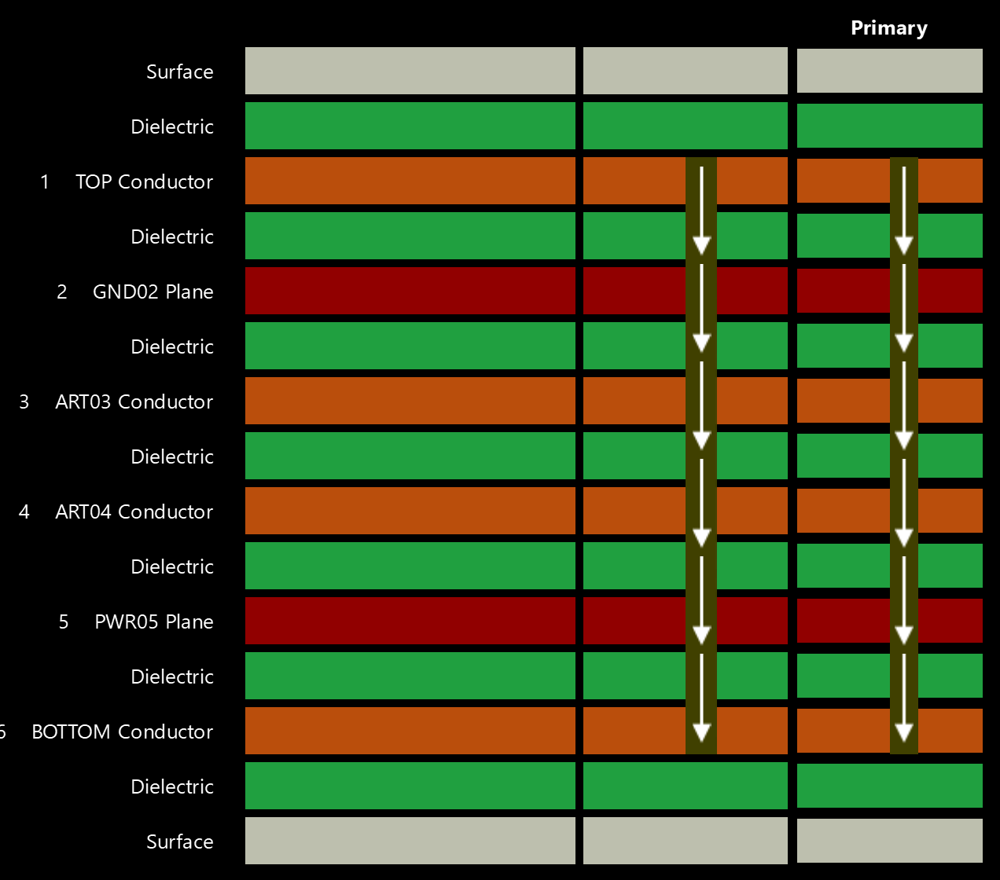

| Parámetro | Valor |
|---|---|
| Capas | 6: TOP · GND02 · ART03 · ART04 · PWR05 · BOTTOM |
| Material | FR408 (εr 3.67), estructura recomendada por Diodes para alta velocidad |
| Espesor | ≈ 62 mil (1.57 mm) |
| Pares PCIe | 85 Ω diferencial, referenciados a un plano de GND continuo |
| Relojes REFCLK | 100 Ω diferencial (≈ 99 Ω calculado) |
| Vía estándar | VIA_0R25D0R50 propia (taladro 0.25 mm, pad 0.50 mm en todas las capas, antipad 0.76 mm, *tented*) |
| Separación mínima | 6 mil línea–línea · 7 mil a zonas de cobre |

### Ruteo de alta velocidad

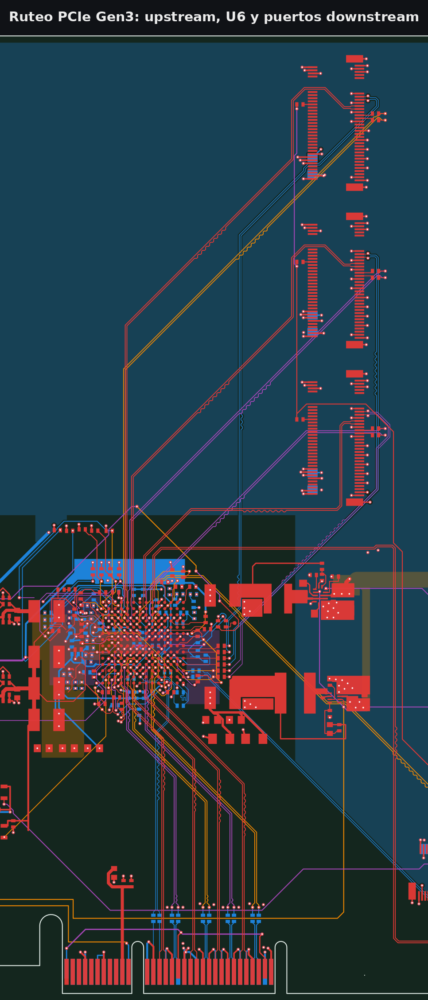

- **Upstream x4**: del conector de borde al switch, con los capacitores de acople AC (0402) junto a los dedos dorados.
- **Downstream x1**: un par TX, un par RX y un reloj de referencia por conector M.2 (J1 a J4).
- **Igualación de longitudes** dentro de cada par mediante serpentines (tolerancia de ±0.3 mil) y separación de 20–25 mil entre pares distintos.
- **Retorno de corriente**: los pares en TOP y ART03 se referencian a GND02, y los de ART04 y BOTTOM a PWR05. Ninguna zona de potencia cruza bajo ellos.
- **Dedos de GND** del conector de borde unidos al plano con vías propias, y vías de costura GND junto a los cambios de capa de los pares.

### Reglas eléctricas (Constraint Manager)

Los 31 pares diferenciales tienen asignado un ECSet según su función. Los anchos y separaciones por capa vienen de los *physical csets* `DIFF_85OHM` y `DIFF_100OHM`.

| Regla | PCIE_GEN3_DATA (42 redes) | PCIE_REFCLK (20 redes) |
|---|---|---|
| Tolerancia de fase (intra-par) | 5 mil | 5 mil |
| Longitud máxima desacoplada | 250 mil | 600 mil |
| Vías máximas por red | 2 | 2 |
| Longitud total | ≤ 10 000 mil | ≤ 10 000 mil |
| Salida de pines (*gather*) | excluida | excluida |
| Tolerancia de acople | +8 / −1.6 mil | +8 / −1.6 mil |

- La tolerancia de +8 mil corresponde a la altura de los *bumps* de ajuste de fase, y la de −1.6 mil al *neck* de 4 mil dentro del BGA. Así, la regla de tramo desacoplado mide las separaciones reales del par.
- Para REFCLK (HCSL de 100 MHz, flancos de ≥ 150 ps, longitud crítica ≈ 0.9 in) se aceptan hasta 600 mil desacoplados. Los datos Gen 3 (flancos de ≈ 30 ps) se mantienen en 250 mil.

### Verificación del layout (DRC de Allegro)

| Verificación | Resultado |
|---|---|
| Errores de DRC | **0** ([`pcb_DRC_electrico.txt`](outputs/reportes/pcb_DRC_electrico.txt)) |
| Componentes sin colocar | 0 de 242 |
| Redes sin rutear | 0 de 170 |
| Conexiones sin rutear | 0 de 686 |

### Footprints propios de los convertidores

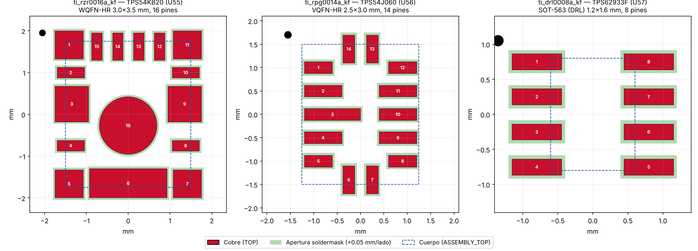

Los *footprints* de Ultra Librarian traían la máscara de soldadura en 1×1 mil, lo que deja los pads tapados. Por eso se reemplazaron por *footprints* propios basados en el *land pattern* recomendado por TI. Cada uno tiene *padstacks* nuevos con apertura de máscara de +0.05 mm por lado, pasta reducida en los pads térmicos, contorno de ensamble, *place bound* y marca de pin 1. Están en `symbols/`: `ti_rzr0016a_kf`, `ti_rpg0014a_kf` y `ti_drl0008a_kf`.

## Componentes principales

| Función | Componente |
|---|---|
| Switch PCIe Gen 3 | Diodes PI7C9X3G808GP |
| Buck 3.3 V / 15 A | TI TPS54KB20 |
| Buck 0.95 V / 4 A (núcleo) | TI TPS54J060 |
| Buck 0.95 V / 1 A (SerDes) | TI TPS62933F |
| LDO 1.8 V y 0.95 V C_VDDC | Diodes AP7361C |
| Inductores de potencia | Coilcraft XAL8080 · XAL5020 · XAL7030 |
| Conectores | Gold finger PCIe x4 · 4 × M.2 M-key 2280 · PCIe 6 pines · Molex 4 pines |

## Herramientas de diseño

| Herramienta | Uso |
|---|---|
| Cadence OrCAD X Capture CIS 25.1 | Captura esquemática y DRC |
| Cadence OrCAD X PCB / Allegro 25.1 | Layout, *stack-up*, ruteo y Gerbers |
| Cadence Padstack Editor 25.1 | *Padstacks* y *footprints* propios |
| TI WEBENCH Power Designer | Dimensionamiento de los convertidores *buck* |
| Git / GitHub | Control de versiones |

## Estructura del repositorio

```
PCIe808_SW/
├── PI7_KEVINFLORES.opj      Proyecto de OrCAD Capture
├── PI7_KEVINFLORES.DSN      Esquemático (15 hojas)
├── abrir_proyecto.cmd       Lanzador (monta la carpeta como unidad P:)
├── allegro/                 Layout de la PCB (.brd) y netlist
├── library/                 Símbolos de Capture propios (.olb)
├── symbols/                 Footprints y padstacks propios (.dra .psm .pad)
├── bom/                     Lista de materiales (CSV y XLSX)
├── fabricacion/             Gerbers y taladros para JLCPCB, y el ZIP listo para subir
├── docs/
│   ├── webench/             Diseño de los convertidores buck
│   └── img/                 Imágenes del README
└── outputs/
    ├── PI7_KEVINFLORES_esquematico.pdf
    └── reportes/            DRC del esquemático y de la PCB
```

## Cómo abrir el proyecto

1. Clonar el repositorio:
   ```bash
   git clone https://github.com/ksflores-cmyk/PCIe808_SW.git
   ```
2. Abrir `PI7_KEVINFLORES.opj` con **OrCAD X Capture CIS 25.1**.
3. Si la ruta contiene espacios, ejecutar `abrir_proyecto.cmd`, que monta la carpeta como la unidad `P:`, porque Cadence no maneja bien las rutas con espacios.

## Estado del proyecto

**Estado: completo ✅**

- [x] Esquemático de 15 hojas con cajetín, índice, diagrama de bloques y un convertidor por hoja
- [x] Diseño de los tres convertidores *buck* (WEBENCH, símbolos y *footprints*)
- [x] Hojas de control: *straps*, SMBus, JTAG, PERST#, LEDs y GPIO
- [x] DRC del esquemático: 0 errores y 0 pines sin conectar
- [x] Netlist importado a la PCB y librería de *footprints* completa
- [x] *Placement* de los 242 componentes
- [x] Ruteo de alta velocidad: 8 *lanes* PCIe y relojes de referencia
- [x] Ruteo de los tres convertidores *buck*, de los LDO y de las señales de control
- [x] Distribución de 12 V, 3.3 V, 5 V, 1.8 V, 0.95 V y 3.3VAUX
- [x] Serigrafía y designadores
- [x] DRC de Allegro en 0 errores, con todas las conexiones ruteadas
- [x] Gerbers, taladros, BOM y PDF del esquemático

## Entregables de fabricación

| Entregable | Ubicación | Formato |
|---|---|---|
| Gerbers (6 capas, máscaras, pasta, serigrafía y contorno) | [`fabricacion/JLCPCB/`](fabricacion/JLCPCB/) | RS-274X |
| Paquete listo para subir a JLCPCB | [`fabricacion/PI7_KEVINFLORES_JLCPCB.zip`](fabricacion/PI7_KEVINFLORES_JLCPCB.zip) | ZIP |
| Taladros | [`fabricacion/JLCPCB/`](fabricacion/JLCPCB/) | Excellon |
| Lista de materiales (BOM) | [`bom/`](bom/) | CSV / XLSX |
| Esquemático completo | [`outputs/PI7_KEVINFLORES_esquematico.pdf`](outputs/PI7_KEVINFLORES_esquematico.pdf) | PDF |
| Reportes de DRC | [`outputs/reportes/`](outputs/reportes/) | TXT |

**BOM:** el costo estimado de componentes para una placa es de **USD 88.29**. El switch PI7C9X3G808GP tiene aviso de fin de vida del fabricante (PCN-2740), por lo que conviene comprarlo con anticipación; no existe un reemplazo compatible pin a pin.

## Aviso

Este diseño es una versión académica personalizada, desarrollada a partir del material de referencia del fabricante proporcionado por el curso. El *design kit* original no se incluye en este repositorio. El contenido se publica con fines educativos y de portafolio; no es un diseño validado para fabricación y se ofrece "tal cual", sin garantía. Cualquier uso o reproducción es responsabilidad de quien lo realice.

## Autor

**Kevin Sebastian Flores López**: estudiante de Ingeniería Electrónica y Telecomunicaciones, Universidad del Istmo de Guatemala.
[github.com/ksflores-cmyk](https://github.com/ksflores-cmyk)
